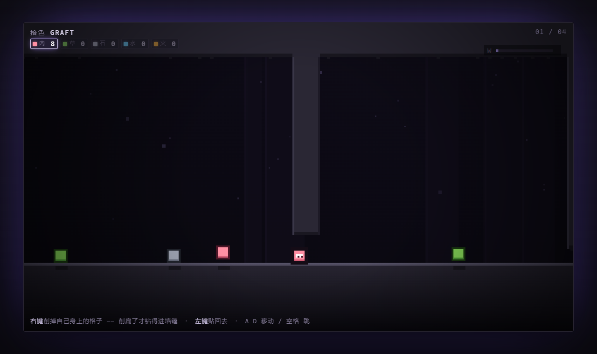

# 拾色 / GRAFT

> **你不是在玩一个像素游戏 —— 你这具身体就是像素。**

一个像素平台跳跃游戏:你的身体由几十个 8×8 像素格组成,每一格都是从世界里抢来的材料。受伤是被削掉,变强是贴上去,而你的**形状**决定了你能去哪、打得过谁。

电脑和手机都能玩;手机上可以"添加到主屏幕",全屏横屏运行。

[设计文档 PRD](PRD.md) · [上线部署与安全](server/README.md) · [MIT License](LICENSE)



## 核心机制

| 机制 | 说明 |
|---|---|
| **身体 = 格子** | 你是一块 3×3 的肉像素。碰撞体只按包围盒算,所以削瘦了才钻得进缝 |
| **受伤 = 削格** | 没有血条。被撞就掉一格,掉光了就散架。回血不是喝药,是从地上抠材料贴回身上 |
| **材质 = 物理** | 贴什么就变成什么:石重、草轻、水软、火烫 |
| **形状 = build** | 要钻一格的缝,先把自己削成一片;要压塌脆地板,先吃成一块石头 |

### 五种材质

| 材质 | 硬度 | 重量 | 特性 |
|---|---|---|---|
| 肉 | 1 | 1.0 | 默认材质,基准 |
| 草 | 1 | 0.5 | 身上贴草可唤醒休眠蘑菇、让种芽长出藤蔓踏板;身体不自动生长 |
| 石 | 3 | 2.8 | 硬碰硬稳赢,能压碎脆地板,但重得跳不动 |
| 水 | 0 | 0.3 | 消耗身上一格水关闭喷口、冷却炽热门;也能抵挡喷火、保护穿越岩浆 |
| 火 | 3 | 0.8 | 贴身靠近荆棘自动烧开;撞击高伤,暂时熄灭后回到背包 |

硬度关系:**火 = 石 > 肉 = 草 > 水**。战斗不是血条对拼,而是"上场前先改装"的准备题。

## 操作

| 电脑 | 手机 | 行为 |
|---|---|---|
| `A` `D` / `←` `→` | 左下左右大按钮 | 移动 |
| `空格` / `W` | 右下 **跳** | 电脑按住跳更高；手机轻点即完整跳跃 |
| 鼠标左键点身旁空位 | 豆板中点空位 / 贴一颗所选豆 | 贴一格 |
| 鼠标左键/触控板点自己(也支持右键) | 豆板中点身体 | 削掉一格(材料回背包) |
| `E` / `Tab` | **豆板** / 点角色 | 打开拼豆板(暂停,放大编辑身体) |
| `1`–`5` / 滚轮 | 点顶部材料 | 切换材质 |
| `Z` | **↶** | 撤销上一次贴/削(只撤自己的操作,不能用来回血) |
| `Esc` / `P` | 右上 **⏸** | 暂停菜单:继续 / 重来本关 / 选关 / 声音 |
| `R` / `M` | — | 重开本关 / 静音 |

## 拼豆探索试玩

标题和暂停菜单都能进入「拼豆图册」。首张图纸免费，累计光种达到 2/5/9/14/21 颗解锁后续五张，解锁不扣光种；选色后点按或滑动穿豆，填满后熨烫收藏并佩戴回关卡。草、水、火、蘑菇、石猫与五色灯塔构成首批六张图纸，半成品和佩戴状态保存在本机。挂件仅改变外观，工坊不会提供免费的关内材料。

关内豆板提供「瘦身钻洞 / 再瘦一层」「收回石豆」「贴一颗所选豆」。遵守原有库存、身体连通和碰撞规则；豆板标出预计跳高，重装压板后可快捷收石再起跳。

参见[拼豆方向与试玩观察](docs/release/拼豆探索试玩.md)。当前仍是网页版探索，不代表已验证留存，也不代表微信原生适配完成。

## 十二关 + 三个试炼

1. **壹 · 缝隙** —— 削扁自己,钻过只有一格高的墙缝
2. **贰 · 撑不住** —— 贴石头变重,压塌脆地板掉进下层
3. **叁 · 过火** —— 带水横穿岩浆,水会烧完,别磨蹭
4. **肆 · 硬碰硬** —— 用材质克制打掉三只敌人,解锁出口
5. **伍 · 先瘦后胖** —— 先削扁钻进矮洞,再吃石头长胖,压塌地板 *(新)*
6. **陆 · 低头过火** —— 岩浆上方压着低矮石板:带够水、压成两格高 *(新)*
7. **柒 · 自己的形状** —— 七级台阶,轻着上去、硬着打赢,出口在最高处 *(新)*

8. **捌 · 草醒森林** —— 身上贴草唤醒休眠蘑菇,靠近种芽长出藤蔓踏板,连续登高
9. **玖 · 石头的开关** —— 上下两层分别配重开门,在重装与轻装间调整,搭浮台登顶
10. **拾 · 水到火熄** —— 水关闭喷口,攀上层点亮水共鸣,再回下层冷却门开路
11. **拾壹 · 火开荆途** —— 削矮穿洞、火烧荆棘;上层火与草双徽记联动开门,藤蔓和浮台两种登顶路线
12. **拾贰 · 洞穴游乐场** —— 石头压开关、水冷却门、火烧荆棘、草唤醒顶层蘑菇,综合运用四种材料

**试炼(比主线紧:材料只够刚好,容错低)**

13. **试炼 1 · 四印** —— 压板要 12.5 重量(两块石头)、水冷红门、火烧荆棘,三种各用一次
14. **试炼 2 · 逆流** —— 顺序反过来:先火、再水、最后石头,材料得一路带着走
15. **试炼 3 · 双闸** —— 两块压板各管一道门,石头不够就把身上的肉削下来凑重量

难度可以再往上加一档:暂停菜单里有 **「硬核」** 开关,打开后散架不回青旗,整关从头来。

每关有 **3 颗可选光种**,高处和旁路藏着额外挑战。选关菜单在通关时记录单关最佳成绩；拼豆图册按位置去重、拿到即保存解锁进度，重试不会丢掉图册里的光种;不收集也能过关。新关中的 **青旗复活点** 会记录当时的身体、材料、机关与收集状态,散架后原地段继续;“重来本关”仍会从关卡起点重新开始。

材料能力需要把色块**贴在身上**,只有背包库存不会触发;改造面板会显示当前材料用途。机关都通过接触或靠近自动触发,没有新按键:蘑菇自动弹起、浮台自动承载、重踏板一次踩亮永久开门、喷火先预警再生效。草仍然只能手动贴,不自动生长。

进度自动保存,下次打开可以“继续”。

## 这一版的体验改动

- **手感**:跳跃/落地的挤压拉伸、跑动扬尘、落地冲击按速度变化、受击击退和短暂顿帧、敌人起跳前蹲下预警、敌人受击无敌帧(不能贴脸秒杀)、道具靠近自动吸附、连续拾取音高上升
- **画面**:每关独立配色主题;三层视差背景(远景废墟 / 钟乳石 / 近景剪影);动态光照(玩家、出口、岩浆、发光蘑菇、水晶、身上的火);苔藓、草丛、垂藤、滴水、岩浆火星;每种材质有自己的纹理动画;角色受伤表情、濒死冒汗;敌人怒眉獠牙、石头怪发光眼和裂纹;伤害飘字、碎块飞溅
- **声音**:程序生成的循环配乐(每个主题一首,有 A/B 段),有敌人或濒死时加入鼓点;每种材质贴上去声音不同;濒死心跳
- **手机**:触屏手柄;竖屏时视野自动变成 3:4、画面更大;暂停菜单(重来 / 选关);撤销;第一关手指动画新手引导;切到后台自动暂停;iPhone 提示添加到主屏幕全屏玩;刘海屏安全区、震动反馈、PWA 图标;掉帧时分级降画质

## 本地运行

```bash
python3 -m http.server 8000      # 打开 http://localhost:8000
```

调试:`index.html?lv=3` 直接跳到第 4 关;游戏内按 `N` 跳关(生产构建会删掉这些)。

## 测试

```bash
bash tests/run_all.sh
```

包含:十二关加载、原关与新关的自动通关、战斗可行性、鼠标/触控板操作、草库存守恒、机关与复活状态、三种材料专属能力与错误材料反例、口令网关 10 项、Nginx 配置静态检查、生产构建检查。需要 Node 和 Python 3,零第三方依赖。

## 上线

见 [server/README.md](server/README.md):Nginx + 访问口令 + 反爬 + 限流 + fail2ban + SSH 加固,一条命令安装、一条命令发布。

```
src/game.js        游戏(Canvas,零依赖)
src/style.css      样式 / 手机布局
assets/            应用图标(tools/make_icons.py 生成)
server/            部署与安全
tools/build.py     生产构建 → dist/
tools/loadtest.py  压测
tests/             自动化测试
```


## 正式微信小游戏准备

当前仍是网页版本,正式小游戏需要移植 Canvas UI、触摸、存档、音频和前后台处理。见[微信发布准备](docs/release/微信小游戏发布准备.md)与[视觉和关卡说明](docs/release/视觉与关卡设计说明.md)。文档区分已经完成的网页内容与尚未完成的小游戏适配、账号与审核流程。
