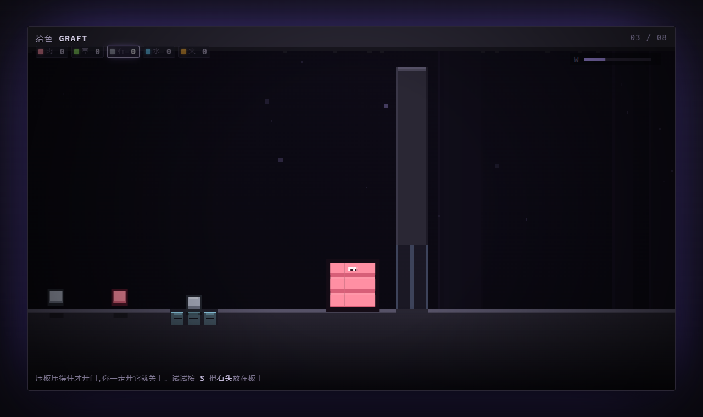

# 拾色 / GRAFT

> **你不是在玩一个像素游戏 —— 你这具身体就是像素。**

一个单文件的像素益智游戏原型:你的身体由几十个 8×8 像素格组成,每一格都是从世界里抢来的材料。**受伤是被削掉,变强是贴上去,而你的形状和材质决定了你能解开什么。**

[**▶ 在线试玩**](https://qjl0201qjl.github.io/graft/) · [设计文档 PRD](PRD.md) · [MIT License](LICENSE)



## 五种材质 = 五个动词

不是数值差异,是**能做完全不同的事**:

| 材质 | 动词 | 你能拿它干什么 | 代价 |
|---|---|---|---|
| **肉** | 基准 | 什么都不会,但也不必付出代价 | — |
| **草** | **生长** | 每 2 秒自己长一格。把身体摊长,就能**架在沟上走过去** | 变宽就钻不进窄道;太轻,压不住压板 |
| **石** | **压重** | 压住压板、压碎脆地板;`S` 放一块在地上当砝码 | 重到跳不起来 |
| **水** | **凝石** | 碰到岩浆,把它凝成石头,**一格水换一格桥** | 用一次就没了;最软 |
| **火** | **焚烧** | 点着藤蔓,整面墙顺着烧穿 | 每 4.5 秒烧掉自己一格 |

三条组合关系,是关卡设计的主力:

- **草 + 沟** = 桥。身体比沟宽,就掉不下去。
- **石 + 压板** = 门。人不能一边踩着板一边走进门,所以你得留一块石头替自己踩着。
- **水 + 岩浆** = 路,**火 + 藤蔓** = 开口。

## 操作

| 输入 | 行为 |
|---|---|
| `A` `D` / `←` `→` | 移动 |
| `空格` | 跳跃(按住跳更高) |
| **鼠标左键** | 指向身体相邻空位,**贴一格** |
| **鼠标右键** | 指向自己,**削掉一格**(材料回背包) |
| **`S`** | 把选中材料**放在脚下**,变成一块可以压板的实物 |
| **`E`** | 把身边的石块**捡起来** |
| `1`–`5` / 滚轮 | 切换材质 |
| `R` | 重开本关 |

削掉的格子会**全额回到背包**,所以削自己永远不亏 —— 只有被敌人打掉才是真损失。

## 八个关卡

**教学(每关只教一件事)**

1. **削薄** —— 墙缝只有一格高,先把自己削掉一层
2. **搭桥** —— 草让你变长,长到比沟还宽
3. **压板** —— 站在板上门会开,但一走开就关。按 `S` 把石头留在板上
4. **压碎** —— 够重,脆地板整片塌;塌完空间变窄,记得再削薄
5. **凝石** —— 一格水换一格桥,数好再走
6. **焚烧** —— 贴一格火,整面藤蔓墙顺着烧穿

**组合**

7. **一石二鸟** —— 石头压板 + 草搭桥,门和沟一样一样来
8. **四件事** —— 薄、长、重、水、火,全部用上

## 运行

零依赖、零构建,双击 `index.html` 就行。也可以起个静态服务器:

```bash
python -m http.server 8000
# 打开 http://localhost:8000
```

调试:`index.html?lv=2` 直接跳到第 3 关;游戏内按 `N` 跳关。

## 技术

- 单文件,纯 Canvas 2D,所有图形用 `fillRect` 画,没有一张贴图
- 内部渲染 640×360(80×45 格 × 8px),2× 跟随镜头
- 身体是一个 8×8 的材质矩阵,**碰撞体只按包围盒算** —— 这一个决定同时给了"削瘦钻缝"和"摊长搭桥"两种玩法
- 材质同时是玩法:身体格子会被火烧、被水凝、被草蔓延
- 音效全部由 WebAudio 振荡器实时合成

## 路线图

- [x] 五种材质各自的动词 / 压板 / 门 / 藤蔓 / 岩浆凝固 / 物块
- [x] 6 个教学关 + 2 个组合关
- [ ] 手感调优(跳跃曲线、贴格反馈)
- [ ] 关卡选择、存档
- [ ] 更多机关:传送、光栅、会剥你格子的 Boss

设计细节、数值表、验收标准都在 [PRD.md](PRD.md) 里。

## License

[MIT](LICENSE) © 2026 qjl0201qjl
